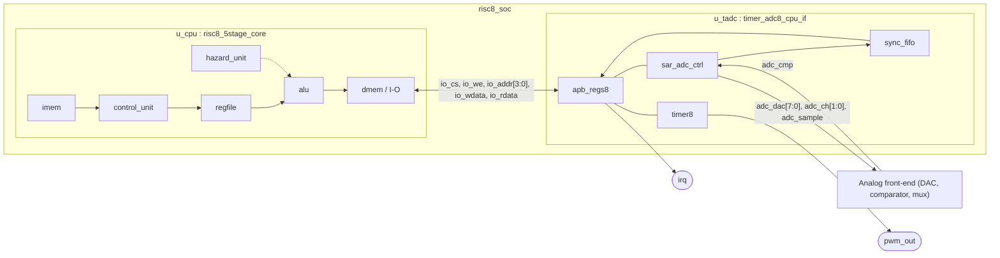
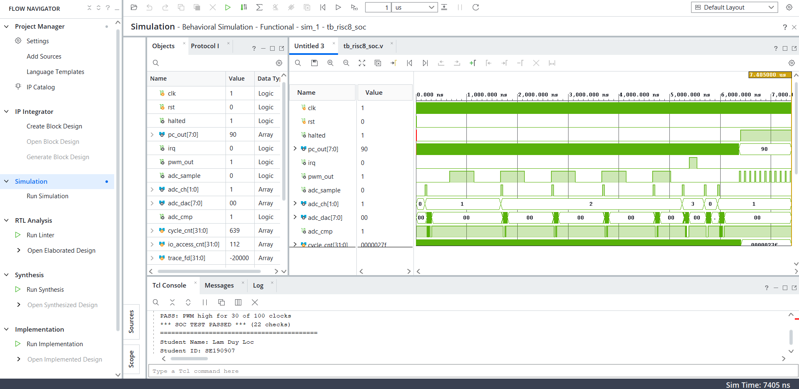
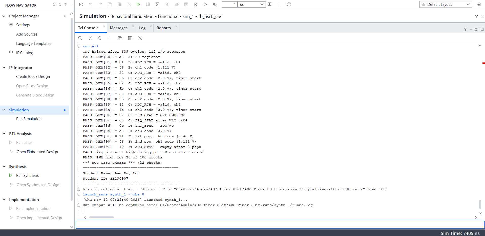
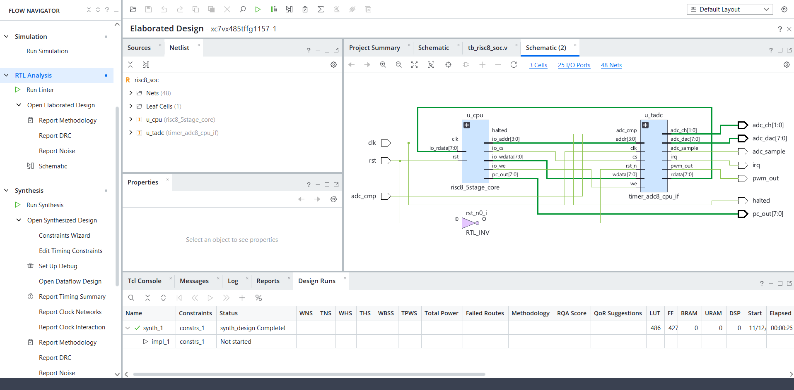
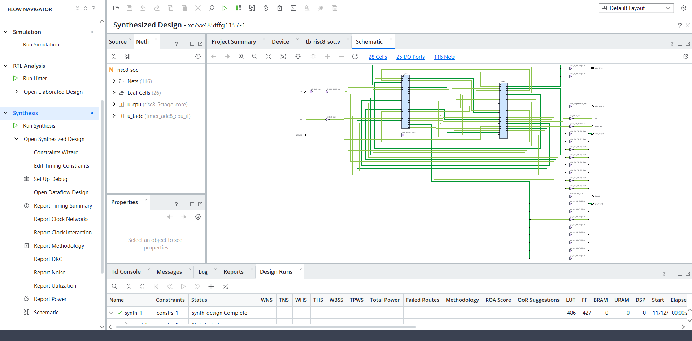
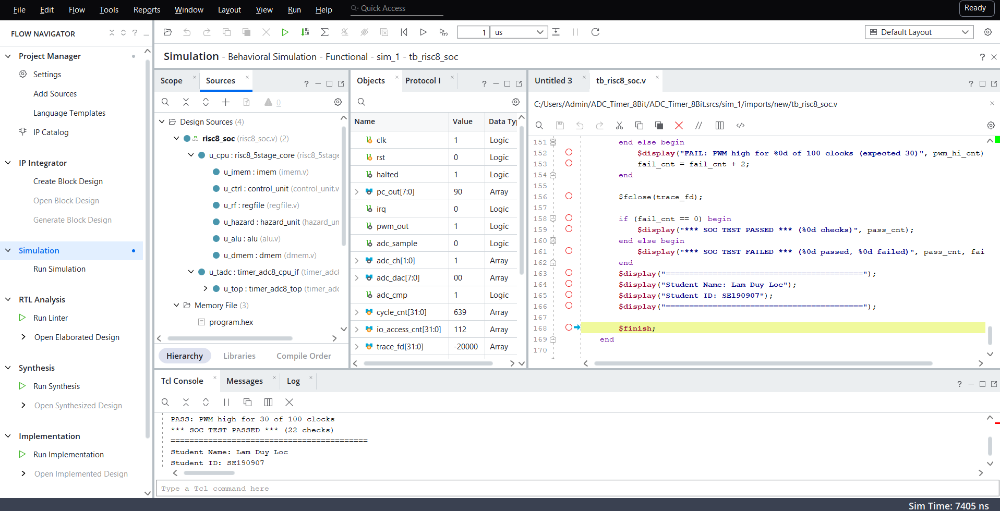
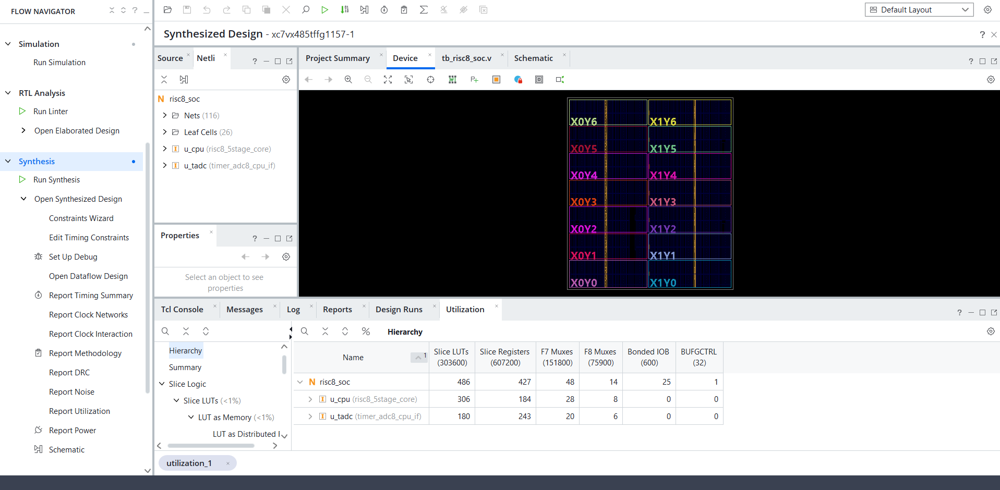

# 8-Bit Timer + ADC SoC (RISC-8 5-Stage CPU + SAR ADC)

A small System-on-Chip written in Verilog. An **8-bit RISC CPU with a 5-stage pipeline** controls a **timer / PWM** and a **4-channel 8-bit SAR ADC** through a memory-mapped I/O page. The design is verified with a self-checking testbench (22 checks) and synthesized with Xilinx Vivado.

| | |
|---|---|
| **Author** | Lam Duy Loc |
| **Student ID** | SE190907 |
| **Language** | Verilog-2001 |
| **Tool** | Xilinx Vivado (simulation and synthesis) |
| **Target device** | `xc7vx485tffg1157-1` (Virtex-7) |
| **Top module** | `risc8_soc` |

## Features

- 8-bit RISC CPU, 16 instructions (16-bit instruction word), 8 registers, 256-byte data memory, 256-word instruction memory
- 5-stage pipeline (IF, ID, EX, MEM, WB) with **operand forwarding** and **load-use stall** (hazard unit)
- Memory-mapped peripheral page at `0xF0 - 0xFF` (16 registers)
- 8-bit timer with prescaler, compare match, one-shot mode and **PWM output**
- 4-channel 8-bit **SAR ADC** controller with programmable sample window, clock divider and **window watchdog**
- 8-entry **result FIFO** (channel + data), 5 interrupt sources with write-1-to-clear status
- Behavioral analog front-end model (mux, sample and hold, DAC, comparator) for simulation
- Self-checking testbench: **22 / 22 checks pass** in 639 clock cycles

## Architecture



### Top-level ports

| Port | Dir | Width | Description |
|---|---|---|---|
| `clk` | in | 1 | System clock (100 MHz in the testbench) |
| `rst` | in | 1 | Active-high synchronous reset |
| `adc_cmp` | in | 1 | Comparator result (1 when Vin >= DAC voltage) |
| `halted` | out | 1 | High after the CPU executes `HLT` |
| `pc_out` | out | 8 | Program counter (debug) |
| `irq` | out | 1 | Interrupt request |
| `pwm_out` | out | 1 | PWM output |
| `adc_sample` | out | 1 | Sample-and-hold switch (1 = tracking) |
| `adc_ch` | out | 2 | Analog multiplexer channel |
| `adc_dac` | out | 8 | SAR trial code sent to the DAC |

## Repository structure

```
ADC_Timer_8Bit_LamDuyLoc_SE190907/
├── sources_1/new/
│   ├── CPU/
│   │   ├── alu.v               # ALU (ADD, SUB, AND, OR, XOR, SHL, SHR, PASS)
│   │   ├── control_unit.v      # Instruction decoder
│   │   ├── hazard_unit.v       # Forwarding and load-use stall
│   │   ├── regfile.v           # 8 x 8-bit register file
│   │   ├── imem.v              # Instruction memory (loads a .mem file)
│   │   ├── dmem.v              # 256-byte data memory
│   │   └── program.hex         # Older CPU-only test program
│   └── ADC_Timer/
│       ├── risc8_soc.v         # Top level
│       ├── risc8_5stage_core.v # CPU core (pipeline)
│       ├── timer_adc8_cpu_if.v # Bus wrapper
│       ├── timer_adc8_top.v    # Registers + timer + ADC + FIFO
│       ├── apb_regs8.v         # 16-register file, IRQ logic
│       ├── timer8.v            # 8-bit timer and PWM
│       ├── sar_adc_ctrl.v      # SAR ADC controller
│       ├── sync_fifo.v         # 8-entry result FIFO
│       └── soc_demo.mem        # Demo program used by the testbench
├── sim_1/new/
│   ├── tb_risc8_soc.v          # Self-checking testbench
│   └── afe_model.v             # Behavioral analog front-end
├── Screenshots/                # Vivado screenshots (F1 - F6)
└── docs/
    ├── ADC_Timer_8Bit_TruthTables_LamDuyLoc_SE190907.xlsx
    └── ADC_Timer_8Bit_Report_LamDuyLoc_SE190907.pdf
```

## CPU instruction set

Instruction word (16 bits): `[15:12] opcode | [11:9] rd | [8:6] rs1 | [5:3] rs2 | [7:0] imm8`

| Opcode | Mnemonic | Operation |
|---|---|---|
| 0x0 | `NOP` | No operation |
| 0x1 | `ADD rd, rs1, rs2` | rd = rs1 + rs2 (sets Z, C) |
| 0x2 | `SUB rd, rs1, rs2` | rd = rs1 - rs2 (sets Z, C) |
| 0x3 | `AND rd, rs1, rs2` | rd = rs1 & rs2 |
| 0x4 | `OR rd, rs1, rs2` | rd = rs1 \| rs2 |
| 0x5 | `XOR rd, rs1, rs2` | rd = rs1 ^ rs2 |
| 0x6 | `SHL rd, rs1` | rd = rs1 << 1 |
| 0x7 | `SHR rd, rs1` | rd = rs1 >> 1 |
| 0x8 | `LDI rd, imm8` | rd = imm8 |
| 0x9 | `ADDI rd, imm8` | rd = rd + imm8 |
| 0xA | `LD rd, [rs1]` | rd = MEM[rs1] (or I/O register) |
| 0xB | `ST [rs1], rd` | MEM[rs1] = rd (or I/O register) |
| 0xC | `JMP imm8` | PC = imm8 |
| 0xD | `BZ imm8` | if Z = 1 then PC = imm8 |
| 0xE | `BNZ imm8` | if Z = 0 then PC = imm8 |
| 0xF | `HLT` | Stop the CPU |

Addresses `0xF0 - 0xFF` go to the peripheral instead of the data RAM.

## Peripheral register map

CPU address = `0xF0 + offset`. RO = read only, W1C = write 1 to clear.

| Offset | Name | Access | Reset | Description |
|---|---|---|---|---|
| 0x0 | `TMR_CTRL` | RW | 0x00 | `[1]` ONESHOT, `[0]` EN |
| 0x1 | `TMR_PRESC` | RW | 0x00 | Tick every PRESC + 1 clocks |
| 0x2 | `TMR_LOAD` | RW | 0xFF | Counter wraps after this value |
| 0x3 | `TMR_CMP` | RW | 0x00 | Compare value / PWM duty threshold |
| 0x4 | `TMR_CNT` | RO | 0x00 | Current counter |
| 0x5 | `ADC_CTRL` | RW | 0x00 | `[5:4]` CH, `[3:2]` TRIG (0 SW, 1 timer ovf, 2 timer cmp, 3 continuous), `[1]` START (self-clearing), `[0]` EN |
| 0x6 | `ADC_SMP` | RW | 0x03 | Sample window = SMP + 1 steps |
| 0x7 | `ADC_DIV` | RW | 0x00 | ADC step every DIV + 1 clocks |
| 0x8 | `ADC_THR_LO` | RW | 0x00 | Window watchdog low threshold |
| 0x9 | `ADC_THR_HI` | RW | 0xFF | Window watchdog high threshold |
| 0xA | `ADC_DATA` | RO | - | FIFO head (reading it pops the FIFO) |
| 0xB | `ADC_RCH` | RO | - | `[7]` VALID, `[1:0]` channel of the FIFO head |
| 0xC | `ADC_STAT` | RO | - | `[6]` BUSY, `[5]` FULL, `[4]` EMPTY, `[3:0]` LEVEL |
| 0xD | `IRQ_EN` | RW | 0x00 | Interrupt enable mask |
| 0xE | `IRQ_STAT` | W1C | 0x00 | `[4]` FIFO_OVR, `[3]` WD, `[2]` EOC, `[1]` CMP, `[0]` OVF |
| 0xF | `ID` | RO | 0xA8 | Fixed ID value |

## ADC: resolution and SAR operation

- **Resolution:** N = 8 bits gives 2^8 = 256 levels. LSB = Vref / 2^N = 3.3 V / 256 = **12.9 mV**.
- **SAR method:** binary search from MSB to LSB. For each bit the controller sets the bit, the DAC makes a trial voltage, and the comparator tells whether Vin is above it. If yes the bit is kept, otherwise it is cleared.
- **Timing:** one bit is resolved every `ADC_DIV + 1` clocks, and the sample window lasts `ADC_SMP + 1` steps.
- **State machine:** `IDLE -> SAMPLE -> CONVERT -> DONE -> IDLE`. At `DONE` the result is pushed to the FIFO (`EOC`) and checked against the watchdog window.

Example: Vin = 2.0 V, Vref = 3.3 V

| Bit | Trial code | DAC (V) | Vin >= DAC | Kept |
|---|---|---|---|---|
| 7 | 128 | 1.650 | yes | 1 |
| 6 | 192 | 2.475 | no | 0 |
| 5 | 160 | 2.063 | no | 0 |
| 4 | 144 | 1.856 | yes | 1 |
| 3 | 152 | 1.959 | yes | 1 |
| 2 | 156 | 2.011 | no | 0 |
| 1 | 154 | 1.985 | yes | 1 |
| 0 | 155 | 1.998 | yes | 1 |

Result: `10011011` = `0x9B` = 155.

## Verification

The testbench `tb_risc8_soc.v` runs the demo program `soc_demo.mem` on a 100 MHz clock together with `afe_model.v`, which provides these input voltages:

| Channel | Vin (V) | Expected code |
|---|---|---|
| 0 | 0.400 | 0x1F (31) |
| 1 | 1.111 | 0x56 (86) |
| 2 | 2.000 | 0x9B (155) |
| 3 | 3.000 | 0xE8 (232) |

The demo program tests the ID register, single conversions, timer-triggered conversions, interrupt flags with W1C, the window watchdog, FIFO pops, and the PWM output. The testbench checks 18 memory locations (`MEM[0x80..0x91]`), the `irq` pin (counts as 2 checks) and the PWM duty (counts as 2 checks).

```
CPU halted after 639 cycles, 112 I/O accesses
...
PASS: irq pin went high during part D and was cleared
PASS: PWM high for 30 of 100 clocks
*** SOC TEST PASSED *** (22 checks)
```

| Waveform | Tcl console |
|---|---|
|  |  |

## Synthesis results (Vivado, `xc7vx485tffg1157-1`)

`synth_1` completed with no errors. Implementation and timing have not been run yet.

| Module | Slice LUTs | Slice registers | F7 Mux | F8 Mux | Bonded IOB | BUFGCTRL |
|---|---|---|---|---|---|---|
| `risc8_soc` (total) | 486 | 427 | 48 | 14 | 25 | 1 |
| `u_cpu` | 306 | 184 | 28 | 8 | 0 | 0 |
| `u_tadc` | 180 | 243 | 20 | 6 | 0 | 0 |

The design uses less than 1% of the device, and no BRAM, URAM or DSP blocks.

| Elaborated schematic | Synthesized schematic |
|---|---|
|  |  |

| Project sources | Utilization report |
|---|---|
|  |  |

## How to run

1. Open Vivado and create an RTL project for part `xc7vx485tffg1157-1`.
2. Add all files from `sources_1/new/CPU` and `sources_1/new/ADC_Timer` as **design sources**. Set `risc8_soc` as the top module.
3. Make sure `soc_demo.mem` is part of the project (as a memory file), so the simulator can load it with `$readmemh`.
4. Add `sim_1/new/tb_risc8_soc.v` and `sim_1/new/afe_model.v` as **simulation sources**. Set `tb_risc8_soc` as the simulation top.
5. Click **Run Simulation > Run Behavioral Simulation**, then type `run all` in the Tcl console.
6. Expect `*** SOC TEST PASSED *** (22 checks)`.
7. To synthesize, click **Run Synthesis** and open **Report Utilization**.

The testbench also writes `io_trace.csv` (cycle, PC, I/O address, data) in the simulation run folder. Define `DUMP` to write a VCD file.

## Documentation

- [`docs/ADC_Timer_8Bit_TruthTables_LamDuyLoc_SE190907.xlsx`](docs/ADC_Timer_8Bit_TruthTables_LamDuyLoc_SE190907.xlsx): 16 sheets of truth tables (control decode, ALU, branch, forwarding, stall, I/O decode, register map, ADC trigger, SAR state machine and trace, IRQ, timer/PWM, FIFO, tests, program listing)
- [`docs/ADC_Timer_8Bit_Report_LamDuyLoc_SE190907.pdf`](docs/ADC_Timer_8Bit_Report_LamDuyLoc_SE190907.pdf): full project report

## Notes

- `soc_demo.hex` in `sources_1/new/ADC_Timer` is an empty file. The testbench uses `soc_demo.mem`.
- `sources_1/new/CPU/program.hex` is an older CPU-only test program and is not used by the SoC testbench.

## Future work

- Run implementation and check timing and power
- Test on a real FPGA board with an external DAC, comparator and analog multiplexer
- Build a UVM testbench with random input voltages, a scoreboard and functional coverage
- Try higher ADC resolution (10 or 12 bits)

## Author

**Lam Duy Loc** - SE190907
